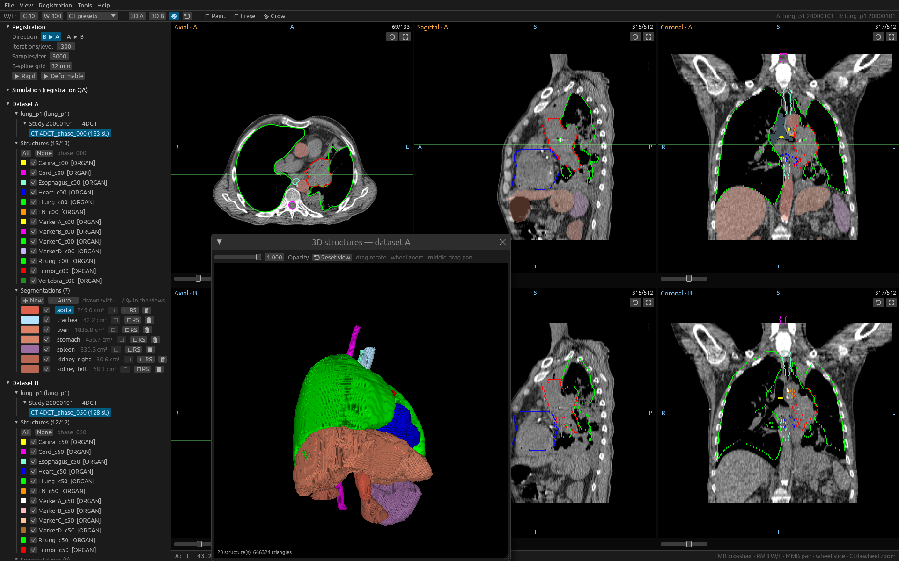

# rust-dicom-station

[](https://snapcraft.io/rust-dicom-station) [](https://github.com/alexprotom/rust-dicom-station/actions/workflows/ci.yml) 

RDS (Rust DICOM Station) is open-source software for medical imaging and radiotherapy research, analysis, and QA, **written entirely in Rust**. It loads complete radiotherapy studies (CT, MR and PET series, RTSTRUCT, RTDOSE, photon and ion RTPLAN, DICOM SEG, planar images, spatial and deformable registrations, and treatment records) into an integrated environment for visualization, comparison and quantitative analysis. Beyond the classic linked MPR layout and multi-workspace comparison (up to four studies side by side), RDS provides image registration, structure propagation, contouring, DRR generation, dose-volume histograms, 4D motion analysis, interactive and AI-assisted segmentation, 3D visualization, DICOM editing and export, a PACS of its own that an optional server shares with other stations, and workflows that run a whole pipeline again on other data, from the viewer or from an AI assistant over MCP. The same program runs on Windows, Linux, macOS, Android tablets, iPad and iPhone. The entire processing stack is native Rust: functionality normally provided through C/C++ or Python frameworks, including elastix- and plastimatch-style registration, ITK-style ray casting, TotalSegmentator, MRSegmentator, lungmask, MONAI SegResNet, CT-FM, VISTA-3D, nnInteractive, SegVol, MedSAM2, and TotalSynth's synthetic CT, is re-implemented directly in Rust without bindings to those frameworks.



*Two breathing phases of the bundled 4D-Lung patient as two rows of linked
MPR views with their RTSTRUCT contours, and the 3D window showing the RTSTRUCT
surfaces together with organs auto-segmented by the built-in TotalSegmentator
engine.*

## Installation

Every push to `main` publishes a release on the
[releases page](https://github.com/alexprotom/rust-dicom-station/releases/latest),
with one package per platform; the project page,
<https://alexprotom.github.io/rust-dicom-station/>, links the newest files
directly.

| Platform | Package | Package manager |
|---|---|---|
| Windows x64 | Installer, `rust-dicom-station-<version>-windows-x86_64.exe` | winget, `RDS.RustDICOMStation` |
| Linux x64 | AppImage, `rust-dicom-station-<version>-x86_64.AppImage` | Snap Store, `rust-dicom-station`; Flathub, `io.github.alexprotom.rust-dicom-station` |
| macOS 12 and newer | Disk images, `-macos-arm64.dmg` (Apple Silicon) and `-macos-x86_64.dmg` (Intel) | Homebrew cask `rust-dicom-station.rb`, attached to every release |
| Android 11 and newer, tablets | APK, `rust-dicom-station-<version>-android-arm64.apk` | none (not in Google Play) |
| iPad and iPhone, iOS / iPadOS 15 and newer | `rust-dicom-station-<version>-ios.ipa` | TestFlight, when a release was uploaded there |

### Windows

Download the installer from the releases page and run it: shortcuts,
"Open with" on folders, the Visual C++ runtime check, an optional download
of any model's weights, and an uninstaller. Or install it with winget:

```
winget install RDS.RustDICOMStation
```

and update it with

```
winget upgrade RDS.RustDICOMStation
```

A newer installer updates an existing installation in place (no second
copy, nothing to uninstall first), and *Start ▸ Update Rust DICOM Station*
fetches the newest release. The installer is not code-signed, so SmartScreen
warns on its first run. Its options, silent switches and the winget details
are in [packaging/windows/installer/README.md](packaging/windows/installer/README.md).

### Linux

* **AppImage** - no installation: download it, make it executable and run
  it.
* **Snap Store** ([docs/snap.md](docs/snap.md)):

  ```
  sudo snap install rust-dicom-station
  ```

  Updates arrive by themselves. USB drives and mounted shares under
  `/media`, `/run/media` or `/mnt` need
  `sudo snap connect rust-dicom-station:removable-media` once.
* **Flathub** ([docs/flatpak.md](docs/flatpak.md)):

  ```
  flatpak install flathub io.github.alexprotom.rust-dicom-station
  flatpak run io.github.alexprotom.rust-dicom-station
  ```

### macOS

Two disk images, both for macOS 12 Monterey and newer:
`rust-dicom-station-<version>-macos-arm64.dmg` for Apple Silicon and
`-macos-x86_64.dmg` for Intel (*Apple menu ▸ About This Mac* says which).
Open the image and drag **Rust DICOM Station** onto *Applications*. Until a
release is notarised, the first launch has to be Finder's right-click ▸
*Open*. Every release also carries a Homebrew cask, `rust-dicom-station.rb`,
for both architectures; where the project's Homebrew tap is set up,
`brew install --cask rust-dicom-station` installs it and
`brew upgrade --cask rust-dicom-station` updates it. See
[docs/macos.md](docs/macos.md).

### Android

The APK is for tablets with Android 11 or later on 64-bit ARM. Download it
on the tablet, open it and allow the installation from this source, or
install it from a computer with `adb install
rust-dicom-station-<version>-android-arm64.apk`. On the first start the
program asks for *All files access*, which is why it is not in Google Play.
See [docs/android.md](docs/android.md).

### iPad and iPhone

One `.ipa` for both, iOS / iPadOS 15 or later (a 4DCT study wants a device
with 4 GB of memory or more). iOS runs only signed apps, so there are three
ways onto a device: **TestFlight** when a release was uploaded there and you
were invited, an **ad hoc** build for devices registered in its profile, or
the release's `.ipa` **re-signed with your own Apple ID** by AltStore,
Sideloadly or Xcode. See [docs/ios.md](docs/ios.md#installing).

### Nightly builds

The rolling [`nightly` pre-release](https://github.com/alexprotom/rust-dicom-station/releases/tag/nightly)
carries the Windows installer and the Android APK of the development branch.
It is never offered as an update by the installed program, winget or
Homebrew ([docs/release-versioning.md](docs/release-versioning.md#nightly-builds)).

### From source

See [Building from source](#building-from-source) below.

## What it does

* **Viewing** - parallel DICOM loading (compressed syntaxes included), true
  patient-space geometry, linked axial / sagittal / coronal views in rows you
  lay out yourself (up to three panes each, the 3D scene among them), W/L
  presets, dose colorwash and isodose lines, per-beam plan summaries, planar
  images (DX / CR / RTIMAGE), dark and light themes. Folders *or* individual
  files, and **the data does not have to be a volume**: a portal image, a
  structure set or a plan opens on its own, in the ordinary tree, with
  everything that does not need voxels still working.
* **Workspaces** - up to four (A - D), one row of panes each; a patient ▶
  study ▶ series tree per workspace; copy / move / remove / rename at every
  level with the reference chains kept intact; RT structure sets and
  segmentation series as tree nodes, contours and masks converting as they
  move between them; the crosshair, the slice, the zoom and the players
  synced across every open workspace.
* **Image information** - what the displayed series actually is, read back
  out of its own headers: voxel spacing, slice thickness and the gap or
  overlap between slices, uneven slice positions, matrix and field of view,
  gantry tilt, frame of reference, kV / mAs / CTDIvol / kernel, rescale and
  units - with whatever wants a second look named and explained, and a side
  by side of what two workspaces disagree about before you register them.
* **Playback** - ▶ on every viewport: through the slices of a view, and
  through the phases of a 4D group. Playing a group carries the structure
  set, the segmentation series and the dose of each phase with it and walks
  the selection down the group in the tree; the phases are read into memory
  once (under a budget you set) so it runs as a cine rather than a
  slideshow, and the 3D window breathes with it.
* **PACS** - *Tools ▸ PACS* shows this station's PACS as cohorts ▸
  patients ▸ studies ▸ series, listed without opening a DICOM file. Several
  rows can be selected with the mouse and the keyboard (Ctrl and Shift
  clicks, the arrow keys, Ctrl+A) to load them into a workspace, rename
  them, move patients between cohorts (no file moves) or move the files into
  other folders. The PACS can span several storage folders, the first being
  the main one where new data is written, and keeps one catalog file,
  `rds-pacs-catalog.json`, in it. Import folders into it, and send the
  structures and segmentations you drew back as derived objects under the
  original Study and Frame of Reference UIDs.
* **PACS server** (optional) - `rds-pacs` serves this station's PACS to the
  others over HTTPS, on the local network or over the internet (through a
  VPN, a forwarded port or a reverse proxy): stations pair with a one-time
  code and the server's pinned certificate, then pull studies into a local
  mirror, work on them offline and sync back, or hand the server workflows to
  run on its own hardware. Every build, Android and iOS included, is a
  client.
* **Registration** - rigid and B-spline after **elastix** (pyramids,
  stochastic sampling, ASGD), dense B-spline after **plastimatch** (analytic
  gradient, bending energy, L-BFGS, mean squares or Mattes mutual
  information) and plastimatch's **landmark warp**; any of them restricted to
  one structure or refined on top of a previous result. **Registration by
  structures** aligns two images on the surfaces of structures contoured on
  both (signed distance maps, a symmetric rigid fit, optionally a local
  B-spline per structure), the voxel values left out. Every run reports the
  Dice of the two images before and after it, per-structure Dice on request,
  6 DOF, displacement statistics, Jacobian determinant and folding; the vector
  field draws in the views and in 3D; fusion overlay; DICOM REG and Deformable
  Spatial Registration read and written; a known-transform simulator for QA.
  The 4 × 4 transform can also be typed in by hand and used in
  place of a recovered one - in the registration, in propagation and in
  transfer by relationship.
* **Structure propagation** - contours and segmentations carried through a
  registration by per-voxel pull-back (no holes, any two grids), optionally
  refined on an enclosing structure first.
* **4D / motion** - phases recognised into 4D groups; the reference phase
  registered to every other, targets propagated and their centroids tracked;
  peak-to-peak, drift, correlation with a reference structure, ITV
  generation, a results window with run-vs-run comparison and CSV export;
  structure comparison (Dice, HD95, surface distance) and transfer by
  relationship.
* **Workflows** - the program's own steps wired into a graph in a node
  editor (*Workflows* in the menu bar): read a folder, find the image, the
  4D group and the structures, segment (by class or by name), register,
  propagate (anchored on a structure), combine and rename structures,
  measure the motion and build the ITV, DVH and dose metrics with a
  protocol, DRRs, export DICOM, file in the archive, write the reports.
  Saved as a small file, run again on other input folders without editing
  it - in the background, or step by step with every result shown in the
  viewer - or as a batch over a folder of patients, with the steps a change
  did not touch taken over from the last run. Undo, copy and paste between
  workflows, frames around groups of steps and a map of the canvas in the
  editor; a command-line runner too.
* **MCP server** - `rds-mcp`, a second executable that lets an AI assistant
  drive the station's tools (load, segment, register, propagate, 4D motion,
  DVH, export, and saved workflows) headlessly over the Model Context
  Protocol, with a ready-made prompt for heart target propagation;
  workspaces that still name their patient are refused by default and no
  tool ever returns identifiers.
* **DRR** - plastimatch's exact Siddon tracer and ITK's interpolating
  ray-cast on one IEC cone-beam geometry, beam's-eye view from an RTPLAN
  beam, side by side with their difference.
* **Dose-volume histograms** - cumulative and differential DVHs of any
  structures against any dose, sampled on the structure's own lattice;
  `D95%` / `D2cc` / `V20Gy` metrics, protocol constraint checking, CSV
  export; verified against an analytic phantom.
* **Segmentation** - spacing-aware 2D / 3D brush and eraser, geodesic region
  growing, undo, live 3D surfaces, mask ⇄ RTSTRUCT, DICOM SEG import and
  export (binary and fractional). The Structure editor edits a segment as a
  whole the way it edits a structure: keep the largest piece, fill the holes,
  grow or shrink by millimetres, or trace it into contours and carry on.
* **Structure algebra** - union / intersection / subtraction / symmetric
  difference with margins in patient directions (exact ellipsoids), crop,
  ring, cleanup.
* **Body contour** - the EXTERNAL structure without the couch, the chair or
  the mask, on CT and MR, classically or guided by TotalSegmentator's body
  network.
* **Auto-segmentation** - 81 automatic models behind one model list, all
  rebuilt natively: TotalSegmentator v2 and v3 (117 structures on CT), its
  MR model, 26 task models (lung vessels and nodules, liver segments,
  head and neck, vertebrae, teeth...) and its 17 licensed ones (heart
  chambers, coronary arteries, tissue types... with your licence number),
  the nnU-Net v1 tumour and organ models (MSD liver, lung, pancreas,
  colon, KiTS, BTCV, SegTHOR), MRSegmentator, lungmask, MONAI's whole-body
  SegResNet, CT-FM, VISTA-3D and NV-Segment-CTMR, plus any nnU-Net v2
  model folder of your own; official weights converted without Python, a
  SIMD CPU engine or a wgpu GPU path (no CUDA), TG-263 names on request;
  mean Dice 0.9995 against TotalSegmentator, lungmask identical voxel for
  voxel.
* **Prompt segmentation** - SegVol rebuilt natively: box, click or free-text
  prompts ("liver", "tumor") for the structures no fixed-class model covers.
* **Slice propagation** - MedSAM2 (SAM 2.1 with its memory bank) and
  Efficient MedSAM2 (EfficientTAM, lighter, for the CPU) rebuilt natively:
  box a structure on one slice, refine with include / exclude clicks,
  follow it through the stack at native resolution.
* **Interactive segmentation** - nnInteractive and VISTA-3D's point mode
  rebuilt natively: click, box, scribble or lasso in any view, positive or
  negative, and every prompt refines the same 3-D object.
* **Synthetic CT** - TotalSynth (the ImpactSynth apps) rebuilt natively
  with KonfAI's prediction recipe: a CT from MR or CBCT, brain to pelvis,
  written as a new CT series of the study on the same frame of reference,
  then judged against a CT of the patient (HU errors per tissue class, SSIM,
  water-equivalent thickness, organ Dice); folders of your own fine-tuned
  checkpoints run the same way.
* **Tools** - DICOM export with an editable tag table, a model manager for
  every downloadable weight, a folder anonymizer with consistent UID
  regeneration, a synthetic RT-study generator; every tool window can be
  moved to its own monitor, and the structure tools live in the modules
  panel.

## Architecture

One language, one binary. All image processing runs on the CPU with `rayon`
and caching; the GPU (`wgpu`: DX12 / Vulkan / Metal) blits the UI and,
optionally, runs the networks. Long operations run on worker threads with
progress and cancellation. The module map, threading model, geometry
conventions and test suites are in
[docs/architecture.md](docs/architecture.md).

## Building from source

Requires a Rust toolchain (<https://rustup.rs>).

```
cargo build --release
cargo run --release -- data-test/TCIA_4D-LUNG/P102/4DFBCT+RTS
cargo run --release -- data-test/TCIA_4D-LUNG/P102/4DFBCT+RTS data-test/TCIA_4D-LUNG/P102/4DCBCT
cargo test --release
```

`--no-default-features` builds a CPU-only viewer without the GPU inference
backend; `--features mcp` adds the MCP server `rds-mcp` and
`--features pacs-server` the PACS server `rds-pacs`, both written beside the
viewer in `target/release/`. The packages of every platform are built from
[packaging/](packaging/README.md), one folder per platform; the Windows
installer is its own crate in
[packaging/windows/installer/](packaging/windows/installer/README.md).

### First steps

No data at hand? *Tools ▶ 📐 Generate test data* writes a complete synthetic
RT study, `data-test/` ships a real patient - a ten-phase 4DFBCT with an RT
Structure Set per phase and the matching ten-phase 4DCBCT
([docs/example-data.md](docs/example-data.md)) - and *Tools ▶ 📥 Download
test data* fetches that folder from GitHub into an installed copy.

To try prompt segmentation on the bundled patient: put the crosshair on the
tumor, unfold *💬 Prompt segmentation* in the Structure auto tools module
(right panel), prompt **Box**, **▶ Segment**.
The engines fetch their weights on first use into one model folder
(`%LOCALAPPDATA%\RustDICOMStation\models` on Windows,
`~/.local/share/RustDICOMStation/models` on Linux,
`~/Library/Application Support/RustDICOMStation/models` on macOS,
`~/snap/rust-dicom-station/common/data/models` in the snap,
`~/.var/app/io.github.alexprotom.rust-dicom-station/data/RustDICOMStation/models`
in the Flatpak), movable from any tool window; each engine also has a headless CLI in [examples/](examples/).

If the program will not start at all, it is almost certainly one thing: a
Windows machine advertising a Vulkan driver that cannot create a device. It
now falls back to Direct3D 12 by itself, the installer asks which backend to
use, and *View ▸ Graphics backend* changes it afterwards - see
[docs/viewer.md](docs/viewer.md#graphics-backend).

## Documentation

https://alexprotom.github.io/rust-dicom-station/

| | |
|---|---|
| [docs/viewer.md](docs/viewer.md) | Loading folders and single files, workspaces with no volume, MPR views, workspace tree, the four workspaces and comparing them, interaction reference, the graphics backend |
| [docs/rt-objects.md](docs/rt-objects.md) | RTSTRUCT, RTDOSE, RTPLAN, REG, RTRECORD, reference chains |
| [docs/registration.md](docs/registration.md) | The four registration engines, registration by structures, local registration, analytics, vector fields, fusion, simulator, verification |
| [docs/propagation.md](docs/propagation.md) | Carrying contours and segmentations across a registration |
| [docs/volumes.md](docs/volumes.md) | How every volume is calculated: voxels-based, surface-based, planimetry, propagation - the exact formulas |
| [docs/motion-4d.md](docs/motion-4d.md) | 4D groups, the motion / ITV workflow, results, structure comparison and transfer |
| [docs/drr.md](docs/drr.md) | Digitally reconstructed radiographs: the two projectors and the geometry |
| [docs/dvh.md](docs/dvh.md) | Dose-volume histograms: curves, metrics, constraint checking, export |
| [docs/segmentation.md](docs/segmentation.md) | Brush / eraser / region growing, 3D view, mask → RTSTRUCT |
| [docs/contours.md](docs/contours.md) | Drawing and editing structures as contours: the draw row and the Structure editor, live wire, smart brush, interpolation, POIs, templates, locking |
| [docs/generators.md](docs/generators.md) | Structures without drawing: grey level (HU or SUV), shapes, isodose, field of view |
| [docs/structure-algebra.md](docs/structure-algebra.md) | Boolean operations, margins, cropping, cleanup |
| [docs/body-contour.md](docs/body-contour.md) | The body / EXTERNAL contour on CT and MR, verification |
| [docs/auto-segmentation.md](docs/auto-segmentation.md) | Automatic segmentation: the 81 models and your own nnU-Net folders, their pipelines, the CPU and GPU engines, validation, TG-263 names, licensing |
| [docs/segvol.md](docs/segvol.md) | Prompt-driven segmentation: the SegVol re-implementation |
| [docs/medsam2.md](docs/medsam2.md) | Propagating a prompt through a stack: the MedSAM2 and Efficient MedSAM2 re-implementation |
| [docs/interactive-segmentation.md](docs/interactive-segmentation.md) | Interactive segmentation: nnInteractive and VISTA-3D's point mode, validation, licensing |
| [docs/synthetic-ct.md](docs/synthetic-ct.md) | Synthetic CT from MR or CBCT: TotalSynth, the module, the recipe, the evaluation against a CT, validation, licensing |
| [docs/pacs.md](docs/pacs.md) | This station's PACS: the window, where and how the studies are stored, filing, loading, sending changes back |
| [docs/pacs-server.md](docs/pacs-server.md) | The PACS server: setting it up on a network and over the internet, pairing stations, mirror and sync, tasks run on the server, security |
| [docs/export-and-tools.md](docs/export-and-tools.md) | DICOM export, the model manager, anonymizer, test-data generator and download |
| [docs/workflows.md](docs/workflows.md) | Workflows: the node editor, the steps, running in the background or step by step, reruns, batches, the run folder, the heart-anchored example |
| [docs/mcp.md](docs/mcp.md) | The MCP server: tools, the heart workflow prompt, patient-identity safety, configuration |
| [docs/architecture.md](docs/architecture.md) | Design, functional overview, module map, threading, the model folder, conventions, testing |
| [docs/release-versioning.md](docs/release-versioning.md) | How versions and releases are produced: the branch flow, nightly builds, winget, the Snap Store, Homebrew, the Android and iOS packages |
| [docs/snap.md](docs/snap.md) | The Linux snap: confinement, where its files are, the MCP server in it, building and publishing |
| [docs/flatpak.md](docs/flatpak.md) | The Flatpak: the sandbox, where its files are, the MCP server in it, building and submitting to Flathub |
| [docs/macos.md](docs/macos.md) | The macOS package: the two disk images, the first launch, Metal, where its files are, building, signing, notarisation, Homebrew |
| [docs/android.md](docs/android.md) | The Android package: installing, all files access, what differs on a tablet, where its files are, building and signing |
| [docs/ios.md](docs/ios.md) | The iOS package for iPad and iPhone: installing (TestFlight, ad hoc, sideloading), getting studies onto the device, what differs on a tablet and a phone, where its files are, building, signing and releasing |
| [docs/example-data.md](docs/example-data.md) | Bundled patient data, source and citations |
| [packaging/README.md](packaging/README.md) | The packaging folder: one subfolder per platform, what each builds and where |
| [packaging/windows/installer/README.md](packaging/windows/installer/README.md) | The Windows installer: building it, what it installs, updating, winget, silent switches |

## License and citations

The code is MIT-licensed. The MIT License 
covers this project's own code; the third-party Rust libraries RDS depends on
keep their own licences, reproduced in
[THIRD-PARTY-NOTICES.txt](THIRD-PARTY-NOTICES.txt). If you publish work
produced with RDS, a citation is appreciated: see
[CITATION.cff](CITATION.cff).

The bundled example data is TCIA **4D-Lung**
patient P102, redistributed under CC BY 3.0 (cite it as described in
[docs/example-data.md](docs/example-data.md)). Auto-segmentation downloads
each model's published weights at your request - TotalSegmentator's open
tasks, MRSegmentator, lungmask, MONAI and CT-FM under Apache-2.0, VISTA-3D
under the NVIDIA Open Model License - and never redistributes them (cite the
model you use as described in
[docs/auto-segmentation.md](docs/auto-segmentation.md)). Prompt segmentation
re-implements SegVol (Du et al., NeurIPS 2024), slice propagation MedSAM2
(Ma et al., 2025) and interactive segmentation nnInteractive (Isensee et
al., 2025, weights CC BY-NC-SA 4.0); their weights are only ever downloaded
from Hugging Face to your own machine at your request and are never
redistributed; see [docs/segvol.md](docs/segvol.md),
[docs/medsam2.md](docs/medsam2.md) and
[docs/interactive-segmentation.md](docs/interactive-segmentation.md).
Synthetic CT re-implements TotalSynth (Boussot et al., 2026; weights CC
BY-NC 4.0), downloaded the same way; see
[docs/synthetic-ct.md](docs/synthetic-ct.md).

This software is a station for research and QA convenience. **Not a medical
device, neither CE-marked nor FDA-cleared, and not for clinical
decision-making.** The ADDITIONAL NOTICE in [LICENSE.txt](LICENSE.txt) states
this in full. It is a statement of fact about the software, not a condition of
the MIT License, which permits commercial use.
