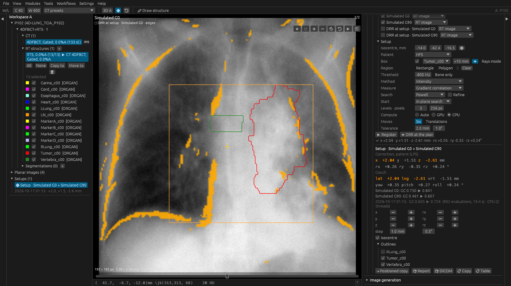

# 2D/3D registration

The pose of the planning CT that makes its digitally reconstructed
radiographs match radiographs of the patient taken at treatment: kV images
of an on-board imager, a room-mounted kV pair, MV portal images. The answer
is the couch (or chair) correction that puts the patient back where he was
planned. *Modules ▶ Image registration ▶ ⌖ 2D/3D registration* (right
panel, F10) runs it on one workspace: the CT and its planar images; the
same engine is behind the MCP tool `register_2d3d`, the workflow step
*2D/3D registration* and the command line `reg2d3d_cli`.

*The 4D-Lung CT of phase 0 posed under radiographs of phase 50: the box
about the tumour, a region drawn on the AP view, the DRR's edges in orange
over the radiograph, the tumour and a vertebra outlined, the correction
amber where it is beyond the tolerance.*

## The conventions, once

Every number the section, the report and the tools give rests on these.

* **The transform maps the room onto the CT** (fixed → moving, as every
  registration of the program does, [registration.md](registration.md)).
  The fixed side is the radiographs: their rays, in the coordinates the CT
  was planned in. The moving side is the CT. `T` maps a room point to the
  CT point that now sits there.
* **`T` is the correction.** Applied to the patient it puts him back where
  he was planned. **`T⁻¹` is the displacement**: the anatomy planned at `q`
  was found at `T⁻¹(q)`. A patient found 5 mm to his left gives a
  displacement of `+5 mm` in `x` and a correction of `-5 mm`.
* **The volume is never resampled.** A rigid motion maps lines to lines, so
  the DRR of the CT at pose `T` is the DRR of the CT as it is, through the
  camera moved by `T`. A rendering costs the same at every pose.
* **The couch readout** expresses the correction in the table top's own
  axes - lateral (`Xt`), longitudinal (`Yt`), vertical (`Zt`), yaw about
  `Zt`, pitch about `Xt`, roll about `Yt` - through the patient's position
  on it (IEC 61217; `iec::couch_readout`). For a head-first supine patient
  lateral is the patient's left, longitudinal is towards the head and
  vertical is up; for a feet-first patient the first two change sign, and
  for an upright patient the yaw is the chair's turn.

## Images and their geometry

A radiograph is a pinhole camera: a source point, the centre of the first
pixel and the steps along a row and down a column, all in patient
millimetres (`projection::ProjectionGeometry`). Each image gets its camera
from one of four places, chosen per image in the section:

* **RT image** - its own attributes (PS3.3 C.8.8.2): *Radiation Machine
  SAD*, *RT Image SID*, *Gantry Angle*, *Patient Support Angle*, *Table Top
  Pitch / Roll* (from the first exposure when there is one), *X-Ray Image
  Receptor Translation* (an absolute position in gantry coordinates,
  `(0, 0, SAD − SID)` when absent) and *Angle*, *RT Image Position* and
  *Orientation*, *Isocenter Position* and *Patient Position*. An image that
  lacks one of them says which (*missing: SID*).
* **A plan beam** - its gantry and couch angles and isocentre, with SAD and
  SID typed beside it and a panel the size of the image at its pixel
  spacing.
* **A room view** - a calibrated view of `imaging-rooms.json` in the
  configuration folder, for a room-mounted pair that has no gantry: the
  camera given outright in the room's fixed frame, or a 3 × 4 projection
  matrix with a detector distance ([drr.md](drr.md#calibrated-rooms)).
* **Typed** - gantry, couch, SAD and SID.

The patient frame - one of the eight DICOM Patient Positions, or upright
facing a direction, from the CT's own Patient Position unless changed - and
the isocentre (the images' own, else the plan's, else the CT's centre;
⌖ takes the crosshair) complete the chain. **👁 DRR at the plan** files the
CT's DRR at the plan's pose for each ticked radiograph and stacks it over
it in the planar panes: the check that the geometry is right before
anything is registered. A radiograph stored with bone dark is read as one
(the polarity is decided against the DRR and reported).

### Portal images

An RT Image whose *Primary Dosimeter Unit* is MU was taken through the
treatment beam. When every radiograph of a run is one, the DRRs are of the
electron density (`HuMode::MegaVoltage`, the attenuation of a 2 MeV beam),
whose bone contrast is as low as the image's. The beam the image references
(or the plan beam its geometry comes from) gives the **aperture**: the jaws
and the MLC of its first control point (`rtplan::Aperture`, photon beams),
in the beam limiting device's axes at the isocentre plane - the gantry's
`Xg`, `Yg` turned by the collimator angle. Projected through the image's
camera (`portal`) it is

* the region the measure compares: the field less 5 mm, since a DRR has no
  field edge;
* an outline over the image in the planar pane;
* where the **field edge** should be: along 72 rays from the field's
  centre, the steepest step of the image within 10 mm of the planned edge,
  across the edge, and the one shift of the field that explains them.

Per portal image the section, the report and the JSON give the field's
shift, the anatomy's displacement at the isocentre in the same axes and the
difference, **field to anatomy**: the number a portal check is for.

## Methods

### Intensity

The radiographs against DRRs of the CT, coarse to fine:

* **The projector** is the interpolating ray-cast of the DRR section (ITK's
  `RayCastInterpolateImageFunction`), marched in index space through the
  CT converted to attenuation once per run (`projection::MuVolume`), with
  coarser copies for the coarse levels: a CT of thin pixels and thick
  slices loses its pixels first. Each level reads the coarsest copy that
  still resolves its pixels at the isocentre.
* **On the GPU** (*Compute*: GPU, or Auto when there is one that is not a
  renderer in software, which is slower at this than the CPU) the same
  ray-cast runs as a WGSL compute shader (`projection::gpu`) on the device
  the networks use: each copy a level reads is uploaded once as a 3-D
  texture, each rendering is read back and the measure computed on the CPU
  as before. The images agree with the CPU's to a millionth of their range
  on average; a ray the GPU's `f32` set-up cuts into one piece more or
  fewer (about one in ten thousand) differs by the midpoint rule's own
  error, at most two thousandths. A GPU that was only preferred and fails
  leaves the run to the CPU; the result says where the renderings ran
  (*Projector*).
* **The measure** (`registration::metric2d`), over a mask that leaves out a
  border of the image and, with a box, what the box does not project onto
  (the DRR is rendered there only, and a few pixels around for the
  measure's kernels):
  * *Gradient correlation* (Penney 1998), the default: the mean NCC of the
    horizontal and vertical Sobel gradients. It sees edges only, so
    scatter, the heel effect and soft-tissue changes do not pull it.
  * *Normalised cross-correlation*.
  * *Gradient difference* (Penney 1998).
  * *Pattern intensity* (Weese 1997), radius 3, σ 10 on images scaled to
    0..255.
  * *Local cross-correlation* (Khamene 2006), windows of 15 pixels at the
    finest level: for portal images whose contrast varies across the field.
  * *Mutual information* (Mattes), 32 bins with the cubic B-spline Parzen
    window.
* **The search** (`registration::optim`): Powell's conjugate directions
  with Brent's line search (the default; ITK's `PowellOptimizer`) or
  Nelder-Mead, over the six parameters in millimetre-like units - a
  rotation counts as far as it moves a point at the clip box's corner -
  within 30 mm and 15° of the start. *Refine* adds a finite-difference
  L-BFGS at the finest level.
* **The start**: the plan, then the *in-plane search* (the default: per
  view the 2D shift of the DRR that best matches the radiograph, the
  shifts of all views solved for one 3D translation through the
  projection's Jacobian at the isocentre) or a *translation grid* (11³
  renderings at the coarsest level). Either brings a start of 20 mm or
  more within reach.
* **The region**: a **box**, a cube about the isocentre or the box about a
  structure with a margin, drawn in the CT's views with 👁, whose shadow on
  each radiograph is what is compared; the **threshold** of the DRR
  (*Bone only* sets 150 HU); and the part of each radiograph compared,
  drawn on it in its planar pane as rectangles or polygons (*Region*: drag
  a rectangle, click a polygon's corners and double-click to close;
  *Clear* takes them all away). The DRRs see the whole CT, as a radiograph
  sees the whole patient. *Rays inside* makes the box a **clip box**: the
  rays integrate inside it only, which renders faster and leaves out what
  lies in front of and behind the region, but also leaves out of the DRR
  what the radiograph still shows; it suits a box that spans the patient
  along the rays, not a small one (on the 4D-Lung case below a tumour box
  with *Rays inside* lost the lateral view altogether).
* **The degrees of freedom**: six, or the three translations.

After the search the curvature of the cost is measured at the answer; a
translation (or a rotation) much weaker than the strongest of its kind is
reported (*Weakly constrained: translation A-P*): one view says little
about the depth along its beam.

### Markers

Fiducials implanted in the target (`registration::markers`):

* **In the CT**: the study's points of interest of type MARKER, or the
  markers found in it - voxels above 1800 HU, components of 1 to 150 mm³,
  each one's centroid weighted by how far it rises above the threshold.
* **On each radiograph**: a difference of Gaussians at the marker's
  projected size, local maxima above four times the noise, refined to the
  centroid of their 5 × 5 neighbourhood.
* **Paired** by their layout first (the common shift that lays the most
  markers on spots, so a start that is far off in the plane still pairs
  each marker with its own), then one to one within the search radius
  (15 mm), again with the pose found.
* **Placed by hand**: *Place* chooses a marker, and a click on a radiograph
  in its planar pane puts it there (a pink cross with its name); a placed
  marker stands for what detection would find in that view, for a seed the
  difference of Gaussians misses or confuses with a clip.
* **The pose**: Levenberg-Marquardt on the projection residuals in
  millimetres at the isocentre, Huber-weighted, with the analytic Jacobian
  of the projection and of the pose. Three markers or more give six
  parameters; fewer give the translations.
* **Triangulated**: a marker seen in two views is placed where its rays
  pass closest; one more than 2 mm (and three times the others) from where
  the CT has it is reported as moved, left out, and the pose solved again
  from the rest.

### Markers, then intensity

The markers' pose as the start of the intensity run: the usual clinical
sequence, and the one that converges from a start too far for the
intensities alone.

## The result

Filed with the study as a **setup** (*Setups* in the data tree: show,
rename, remove) and put on screen: each radiograph in a planar pane with
its DRR at the answer stacked over it, where the pane's compare modes -
fade, checkerboard, difference, edges - show how well the two agree, and
over both the isocentre, the markers (found ○, predicted ×, the residual
between them, red for a marker that moved) and the outlines of chosen
structures (the structure projected through the same camera at the same
pose, contoured: the target's shadow on the radiograph).

The section's rows give the **correction** in patient coordinates and as
**couch** moves, each number amber when it is beyond the **tolerance**
(2 mm and 1° unless changed; the measure, the search, the tolerances and the
last room chosen are remembered between runs), the similarity of each view
before and after (amber when it ends below 0.3), the marker residuals, any
warning and where the renderings ran. The **nudge**
buttons move the pose by hand, a millimetre or half a degree at a time,
and draw the DRRs again: the manual registration every system has. The
apply row:

* **⇥ Positioned copy** - the study as the patient was found (the CT moved
  by the displacement, its structures, doses and isocentres with it) in a
  free workspace, registered to the CT (the copy fixed, the CT moving), so
  fusion, the crosshair link, propagation, the DVH of the positioned
  anatomy and structure comparison work on it as on any registered pair.
* **💾 Report** - the numbers as JSON.
* **💾 DICOM** - into a folder: the correction as a rigid Spatial
  Registration (from the radiographs' frame of reference - or a new one,
  named in the description, when they share the CT's - onto the CT's), the
  DRRs at the answer as RT Images with their geometry, and the report.
* **📋 Copy** - the report as text, the 4 × 4 matrix (room to CT) at its
  end; **📋 Table** - the numbers tab-separated, for a spreadsheet.

Two radiographs fill the row's two planar panes; a third (a triple
exposure, a second pair) is a click in the tree away, its DRR stacked on it
the same way.

## The other ways in

* **MCP** ([mcp.md](mcp.md)): `register_2d3d` (and `register_2d3d_async`)
  with the planar images by number or label and the geometry, the region
  (polygons in pixels) and the markers placed by hand per image; the
  device is the server's `device` setting;
  `describe_setup`; `export_setup` writes the DICOM and the JSON into the
  output folder. Labels from the files pass the redactor.
* **Workflows** ([workflows.md](workflows.md)): *2D/3D registration* takes
  an image series and the planar images of its study, files the setup and
  writes the files; *Positioned copy* moves the series by its pose (or by a
  displacement typed into the step: the transform simulator as a step) and
  hands on the copy and its registration.
* **The command line**: `cargo run --release --example reg2d3d_cli -- <CT>
  <images...>`; `--simulate tx,ty,tz,rx,ry,rz` renders radiographs of the
  CT itself with the patient displaced, registers them and prints the
  error - the one-command self-test on any CT; with `--out` it also writes
  them as RT Images to load with the CT. `--bench` times the projector,
  `--device gpu` puts it (and the registration's renderings) on the GPU.

## Validation

`tests/registration_2d3d.rs` (run with `--release`) on a torso phantom
whose radiographs are rendered from the phantom function sampled afresh at
the true pose (another grid, a finer step, 1 to 2 % noise), not from the
CT through a moved camera:

| Case | Result |
|---|---|
| Two views, 6 mm / 3° in every axis, NCC and gradient correlation | below 0.5 mm and 0.3° |
| A 5 mm shift to the left, HFS, FFP, FFS and upright | displacement `+5`, correction `-5`, couch lateral as each mounting says |
| One AP view | the in-plane translations to 0.5 mm, depth reported weak |
| 21 mm and 4° away, in-plane search | below 0.5 mm and 0.3° |
| 35 mm away, translation grid | below 0.5 mm |
| Radiographs stored bone dark | inverted and registered |
| 1, 2 and 8 threads | the same answer to the bit |
| Three seeds, two views | below 0.4 mm at the seeds |
| One seed | the translations, below 0.3 mm |
| A seed moved 6 mm | reported, left out, the pose from the rest |
| Markers, then intensity, from 29 mm | below 0.5 mm and 0.3° |
| RT Image and rigid REG written and read back | the camera to 1e-6 mm, the transform to 1e-6 mm |
| A portal image, the patient 2 mm to his left, the field delivered 3 mm off | the anatomy to 0.5 mm, the field shift to 0.5 mm, field to anatomy +1 mm to 0.7 mm |
| The projector on the GPU (`RDS_GPU_TESTS`, `--ignored`) | the CPU's images to 1e-6 of their range on average, 2e-3 at the odd ray |
| A registration on the GPU | the CPU's answer to 0.003 mm and 0.01° |

On the 4D-Lung patient of `data-test/` (512 × 512 × 133, 0.98 × 0.98 ×
3 mm), `--simulate 4,-3,5,2,-1.5,3 --pixels 128 --clip 300` recovers the
displacement to 0.02 mm and 0.01°, at most 0.09 mm at the corners of the
box. The projector on the same CT, two threads of the build machine:

| Detector | Step | Time |
|---|---|---|
| 512 × 512 | 1 mm | 3.1 s |
| 256 × 256 | 2 mm | 0.44 s |
| 128 × 128 | 4 mm | 0.06 s |

A registration of two views at 96 pixels takes 5 to 20 seconds there
(the DRRs are rendered only where the measure reads them); a desktop with
eight cores is several times faster, and the levels read coarser copies
of the CT than these timings do.

**Against the 3D registration, on real anatomy.** With `--drr-of` the
radiographs are rendered from another CT of the same patient - the anatomy
the patient brought on the day, under which the planning CT has to be
posed - and `--compare-3d` registers the two CTs in 3D (the rigid
elastix-style engine, inside the same box, over the voxels above the same
threshold). The correction's translations, and how far apart the two
answers are at the box's centre and at its worst corner:

| Planning CT | Radiographs from | Box | DRR | 2D/3D, mm | 3D/3D, mm | Apart: centre, corner |
|---|---|---|---|---|---|---|
| 4D-Lung phase 0 | phase 50 | spine, 80 mm cube | bone, 150 HU | -0.0, -0.1, +0.0 | -0.0, +0.1, +0.1 | 0.24, 0.53 mm |
| 4D-Lung phase 0 | phase 50 | tumour, 15 mm margin | -800 HU | +2.4, +1.6, -2.3 | +2.3, +1.7, -1.7 | 0.63, 0.94 mm |
| 4D-Lung phase 0 | cone-beam CT, phase 0 | spine, 80 mm cube | bone, 150 HU | +1.6, +1.8, -0.1 | +1.2, +1.9, -0.1 | 0.39, 2.05 mm |

Gradient correlation, an AP and a lateral view, 96 pixels. The spine does
not breathe and the tumour does: on the same two phases the two boxes give
answers 3.6 mm apart, each the 3D registration's for its own box. The
cone-beam CT is another scanner on a treatment day, with a truncated
field: the spine agrees at the box's centre, the rotations to about a
degree. Its soft tissue does not carry a registration: the tumour box
ended at a gradient correlation of 0.38, 7 mm from the 3D answer. The
same tumour box with *Rays inside* (`--clip-rays`) found nothing: the
lateral DRR of the box alone is not what a lateral radiograph of the chest
shows.

## Acceptance in a room

The numbers above are simulations or other scanners. Before the program's
corrections are used in a room, the room's own images decide, with an
anthropomorphic phantom (or any rigid one with bone and a few markers) and
its planning CT:

1. Image the phantom at the planned position: the correction should be
   within the tolerance of zero, and **👁 DRR at the plan** should lie on
   each radiograph. A shift there is the geometry (the vendor's receptor
   translation, the image's orientation, a kV source angle that is not the
   gantry's), not the registration: correct it with the image's geometry
   source (*typed*, a beam, a room view) before going on.
2. Move the couch by six known offsets, a few millimetres and a degree or
   two along and about each axis, imaging each: the correction should
   undo each offset to 1 mm and 0.5°, with the signs of the couch readout
   the console shows.
3. For a room-mounted pair, the same images give the calibration of
   `imaging-rooms.json` ([drr.md](drr.md#calibrated-rooms)), checked by
   the same six offsets.

Keep the images: they are the room's reference when the software or the
imager changes.

## Not yet

* A *Track* mode for a cine, every frame from the last.
* A room's calibration solved from a phantom acquisition (the 3 × 4 matrix
  from known marker positions); the matrix is typed into the rooms file.
