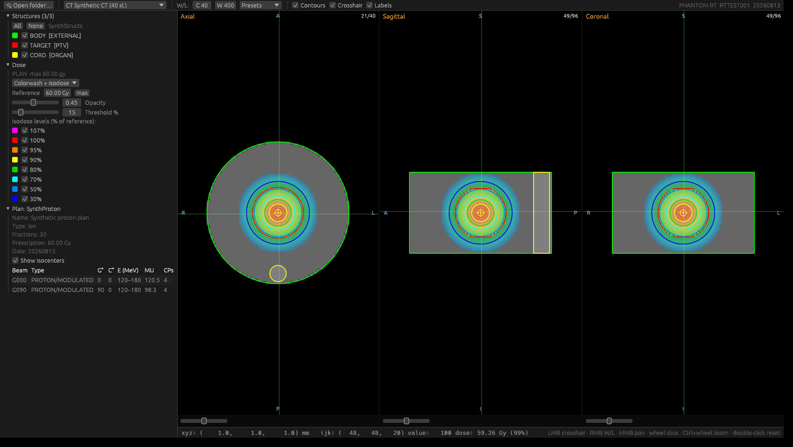
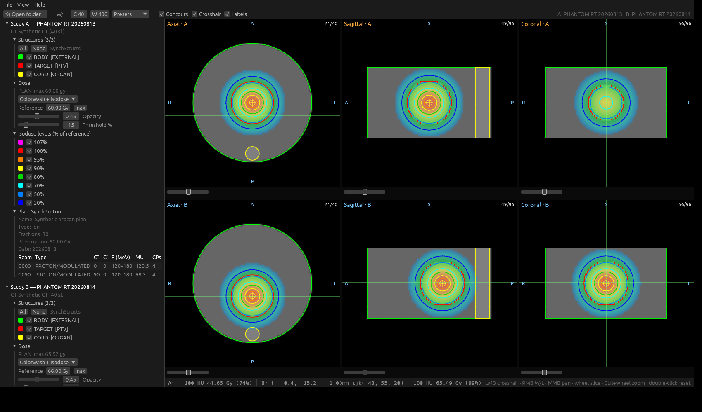

# Image viewing, workspaces and interaction



*A lung 4DCT phase with its RT Structure Set. The crosshair sits in the tumor;
the axial view draws the native RTSTRUCT contours, sagittal/coronal show
reconstructed cross-sections of the same ROIs.*

## The start screen

With nothing loaded the window is two panels, **Input** and **Tools**, each a
wide button over a pair of narrow ones. The wide button is the one that
starts the work; the two below it are the shortcuts.

**Input**

* **Add DICOM folder** scans a folder into workspace A. This screen is only
  up when nothing is loaded at all, so there is nowhere else for it to go;
  the menu entry of the same name asks.
* **Restore last session** loads again what was open when the program was last
  closed. Each workspace's sources are remembered in `session_a` to
  `session_d` in the settings file as they are loaded, so an unclean exit
  loses nothing. If the folders it names have since moved or been deleted, it
  says so and forgets the session.
* **PACS** opens the local patient archive and the paired servers; an
  empty archive is where its storage folders and the pairing get set up,
  so the button is always live.

A button that cannot do its job is greyed rather than hidden - there is no
last session - so the screen keeps the same shape and the answer to "where
has it gone" is on the button itself.

**Tools**

* **Generate test data** writes a synthetic RT study to try the program on.
* **Anonymize DICOM folder** opens the anonymizer.
* **Download test data** fetches the bundled real patient - a ten-phase
  4DFBCT with structure sets and the matching 4DCBCT - from GitHub
  ([export-and-tools.md](export-and-tools.md#real-test-data-from-github)).
* **Downloaded models** opens the model manager.

## Loading and volume reconstruction

Data comes in either way round: a whole folder (*File > Add DICOM folder*, or
directory arguments on the command line) or an explicit handful of files
(*File > Add DICOM file(s)*, multi-select). Both start the same background
scan and both merge into the workspace the same way - a file selection is not a
separate mode with its own rules, it is a study that happens to be small.

The scan:

1. **Classification.** Every file in the tree is read header-only (no pixel
   data) in parallel and classified by SOP class / modality: image series
   (CT/MR/PT/…), RTSTRUCT, RTDOSE, RTPLAN, planar images (DX/CR/RTIMAGE),
   Structured Reports (a CT dose report, any SR), additional objects
   (secondary captures, whatever Modality they claim; a scanner's protocol
   page among them becomes a report once its text is read), REG spatial
   registrations, RT treatment records. Unreadable or foreign files become
   warnings, never errors.
2. **Series grouping.** Image files are grouped by SeriesInstanceUID into the
   workspace tree; the largest series is reconstructed first (click another to
   switch). Series of equal length - the phases of a 4DCT - follow in series
   number order, so a folder numbers its series the same way on every
   machine, whatever order the disk lists the files in.
3. **Volume reconstruction.** Slices are decoded in parallel (`rayon`) -
   compressed transfer syntaxes (JPEG lossless, RLE, …) via `dicom-rs`'s
   pure-Rust decoders - sorted by projection onto the true slice normal (cross
   product of the ImageOrientationPatient row/column vectors), checked for
   uniform spacing and consistent dimensions, and rescaled to HU with the
   per-file rescale slope/intercept. When that rescale lands on integers
   (slope 1, an integer intercept - every CT) the pixels are converted
   straight into the volume's `i16`; only a fractional rescale (PET counts,
   say) goes through a floating-point pass and a rounding. The result is one
   `i16` volume with full patient-space geometry (origin at the center of
   voxel (0,0,0), unit direction vectors for the three axes, spacing in mm).

Non-uniform slice spacing is reported as a warning (the median spacing is used
for display) and duplicate slice positions are collapsed. Enhanced multi-frame
image series are not yet supported (classic single-frame only). RT objects
found in the folder are parsed alongside and attached to the study - see
[rt-objects.md](rt-objects.md).

### Workspaces with no volume

Not everything worth opening reconstructs into slices, and a viewer that
insists otherwise is a viewer you cannot use to look at a portal image. So
**a workspace without an image volume is a normal workspace here**, not a failed
load. Three cases arrive at it:

* the selection holds only RT images, DX/CR radiographs or other projection
  images - nothing with slice positions to stack;
* the selection holds only RT objects - a structure set, a plan, a dose grid,
  a registration, a treatment record;
* an image file carries no `ImagePositionPatient` at all. That is judged per
  *series*, not per file: a series where nothing is positioned cannot be
  reconstructed and its files are opened as single images, while a series
  where one slice happens to lack the tag is still a series. Before, such
  files were dropped silently.

Such a workspace appears in the tree under its patient and study exactly like
any other, and everything it holds is usable: planar images open in their
viewers (the *Planar images* section opens itself, since for these workspaces it
is the content rather than a footnote), structure sets render in the 3D
window, plans and dose objects show their tables, and any of it can be
renamed, copied to another workspace or exported. What is held back is only
what needs voxels: the MPR views say so in place of three black panes, and the
segmentation tools, the four engines, registration, propagation, combination,
comparison and the DRR are disabled until there is something to run them on.

Adding an image series afterwards completes the workspace. *File ▶ Add DICOM
folder*, answered with the same workspace, merges the images in and the views
switch to them - which is the ordinary way to open a structure set first and
its CT second, and have the contours land on the right images.

## The rows and their panes

The main area is **one row per open workspace** - up to four, **A** to
**D** - and each row shows up to **seven panes**, chosen under *Settings ▸
View layout*: the **axial**, **sagittal** and **coronal** planes, the
**3D** surface scene, the two **planar panes**, *Planar 1* and *Planar
2*, which show the workspace's planar images (radiographs, RT images, DRRs;
see [Planar images](#planar-images-dx--cr--rtimage) below), and the
**Additional** pane for what it holds besides images of the patient (a
dose report or a scanner's protocol page as a table, a secondary capture as
an image; see [Reports](#reports) and [Additional](#additional) below). The planar and additional panes are not in the
standard row, and one in a row whose workspace holds no image of its kind
is not drawn at all, so a plain CT keeps its three planes whatever the
layout says. The rows share the height equally and are chosen
separately, so the planning CT can sit above one plane of the repeat scan,
or a single large axial above the same plane of another workspace. A
workspace appears as soon as something is loaded into it and goes when it is
emptied; *View ▸ Workspaces* puts one aside without unloading it.

The panes of a row split its width evenly, so a row of two is two large
images rather than two and a gap, and a row of one is one image across the
window. A row always shows something: the last tick of a row cannot be
taken off, and a tick greys out once the row holds as many panes as it
carries - every kind there is, so a row can hold the three planes, the
surface scene, both planar panes and the additional pane at once. The **◀ ▶** buttons beside each tick move that pane
one place left or right in the row, and the list is drawn in the row's own
order, so it reads left to right the way the row does; a newly ticked pane
joins at the right. **⟲ Reset** beside a row's heading puts that row back to
the standard three - axial, sagittal, coronal, in that order - in one click,
and greys out when the row is already that. The choice is remembered between
runs (`view_row_a` to `view_row_d` in the settings file, which can also be
edited by hand). Both
that submenu and the **View** menu are sets of switches rather than lists of
actions, so ticking one leaves the menu open and a whole layout can be put
together in one visit; they close on a click outside them or on their own
title again.

The MPR panes carry **linked crosshairs**: clicking a point in any of them
moves the others to that patient-space position. Planes are extracted in
acquisition index space; oblique acquisitions display consistently but their
plane names are nominal, and the anatomical edge labels (L/R/A/P/S/I) always
reflect the true patient directions from the direction cosines.

The panes tile the central area edge to edge, each with its own **slice
scrubber** drawn over its bottom edge; the plane and workspace name in the
top-left corner is white in every pane, the edge labels keep their colour.
The corner buttons (named on hover), right to left: **⛶ / ⊞** maximizes the
pane and restores the layout, **◀ / ▶** folds the rest of the bar away and
brings it back - one switch for every pane, remembered between runs, and
folded on a fresh installation so a viewport opens with nothing over the
anatomy - then **⟲** resets the pane's zoom and pan and re-centers the
crosshair in the volume, **✋** hands the left button the
image - drag it and the image moves instead of the crosshair, as a middle
drag always does - and **➕ / ➖** zoom a step about the middle of the pane.
The hand is one switch for every pane of both workspaces. The toolbar holds a
global **⟲** (the same reset for every pane of both workspaces), the **⌖**
crosshair toggle (while hidden,
left-click navigation is off and slices change only by scrolling), the
**Sync** toggle beside it (shown whenever two or more workspaces are loaded - see
below), the **3D A / 3D B** buttons and the segmentation tools.

**The 3D scene** can live in a row or in a window. Ticking **3D** for a row
draws it there, and the pane is furnished like any other: **3D** (with the
workspace's letter while more than one is open) in the top-left corner, and the same
corner buttons in the same places - **⛶ / ⊞**, **◀ / ▶** (the same fold,
the same switch), **⟲** (the camera back to its default angle, centred on
the structures, fit zoom and no offset), **✋** (a left drag moves the
scene instead of turning it), **➕ / ➖**, and the **▶4D** transport with
**Prepare** beside it where the workspace has a 4D group. What only a scene
has sits under them, wrapping onto another line where a pane is narrow:
**Opacity** with its percentage, **Structures**, and **Dose** / **Isodose**
where the workspace carries a dose. **Structures** lays the per-structure
opacity panel down the pane's right-hand edge, the same panel and the same
sliders the window shows. While a row carries the scene, that workspace's
**3D** button leaves the toolbar - there is no window to open - and it
comes back when the tick does.

A pane keeps its scene between frames the way a window does, and so its
camera too - until the workspace shows a different image. Then the camera
starts over, exactly as a freshly opened window would: default angle, no
zoom or offset, centred on the new structures and scaled to them. A view
kept across images would orbit a point of the last patient's anatomy, at
the last image's scale, and a structure of the new one would swing round
the edge of the pane when turned. Stepping through the phases of a 4D group
is not a new image in this sense - the phases are one patient a moment
apart - and the view holds still while they play.

**The 3D window** (3D A / 3D B) meshes the active structure set and keeps
up with it: a structure moved or redrawn in the Structure editor is
re-meshed in the background while the scene stays on screen, and the
editor's drawn axis is shown in it. Its camera buttons - **➕ / ➖**, **✋**
and **⟲** - sit in the window's top-right corner, where a pane keeps them.
The *Opacity* slider is the whole scene's; the **Structures** toggle opens
a panel with one slider per structure on top of that, so the target can
fade while a chamber volume stays solid (*All 100 %* clears them). With a
dose in the workspace, **Dose on the surface** colours every surface by the
dose that lands on it, on the
isodose scale, and **Isodose surfaces** adds the active dose as translucent
shells at the isodose lines switched on in the Dose display, in their
colours and relative to the same reference dose, with their own opacity
slider; they follow a change of dose, reference or lines by themselves.

**Window/level.** Right-drag on any view adjusts interactively
(x = width, y = center); the toolbar offers numeric fields and the presets of
the modality shown, read off the active series of the workspace last pointed
at (the toolbar names it, *W/L A:*, when several are open):

* **CT** - Hounsfield windows: brain, subdural, stroke, head/neck soft tissue,
  temporal bone, lungs, mediastinum, abdomen, liver, spine, bone, CT angio.
* **MR, PET and any other modality** - their values have no fixed scale (an
  MR's are the scanner's arbitrary signal, not Hounsfield units), so the
  presets are read off the image itself: *Series default* (the window the
  DICOM files carry, or the one below), *Auto* (the 1st to the 99th
  percentile of the image's values), *Wide* (0.5 - 99.9 %), *Narrow*
  (5 - 95 %), *Dark tissue* (0 - 60 %) and *Bright tissue* (30 - 99.9 %). The
  padding outside the field of view is left out of the count.

*Full range* closes either list. The list shows each preset's center and
width; the closed list carries only the chosen name, and any other window - a
drag or the full range - leaves it nameless.

A series comes up with the window its files carry; without one, a CT with the
soft tissue window (C 40 / W 400) and anything else with the *Auto* window.
**Each workspace has its own window, and workspaces showing the same modality
share it**: two CTs side by side (two phases, a planning CT and a re-scan) are
read with one window and a change to it moves both, while a CT beside an MR
keeps a window of its own for each. A series that comes up in a workspace
takes the window of another workspace showing its modality, if one does.

**Every tool has its own window.** The PACS, the model manager, the 3D
scenes, the segmentation, motion and DVH tools, the export and
anonymizer dialogs - none of them float inside the main window. Each opens as
a window of the operating system in its own right, with its own title bar and
task-bar entry, to be dragged onto a second or third monitor, resized or
maximized there, and left open beside the images while the main window keeps
all six viewports. Any number can be open at once, on any mix of screens, and
each one reopens at the size and place it was last left - on the monitor it
was left on. Closing a window closes that tool alone. Each has a **📌 Keep
on top** switch in its top right corner: on, the window stays above the
main window (and everything else) while it is open. It is off whenever a
window opens and is not remembered between runs.

Every window of the program is titled the same way: **Rust DICOM Station:**
followed by what the window is - *Viewer* for the main one, then *Picture
Archiving and Communication System (PACS)*, *Downloaded models*, *DRR -
workspace A*, and so on.

**Status bar.** Patient coordinates, voxel indices, the image value (in HU
for a CT; *MR value 812* for an MR, whose values have no unit) and dose (Gy
and % of the reference dose) at the crosshair; with more than one workspace open each
reports the full set side by side, at its own crosshair. Hover the **?** at the
right end to read the active tool's mouse bindings.

**View ▸ Workspaces** lists all four letters with a tick each: which of them
are on screen. A is always shown; a workspace holding data is ticked as soon
as something is loaded into it, and unticking one puts its row aside without
unloading anything - the tick brings it straight back. Ticking an empty
letter opens a row that offers to load into it, and that row carries a
*Close this workspace* button of its own. Emptying a workspace with *File ▸
Clear workspace* closes it; the letters of the others never shift, because a
registration, a propagation and every window title names workspaces by
letter.

**The two panels.** The left one is the data tree, the right one the modules.
Each hides and shows from the *View* menu (*Data tree*, *Modules*), from a
shortcut (**F9**, **F10**) and from the arrow on its edge of the window;
dragging a panel's inner edge past the minimum does the same, and the arrow
brings it back.

The *Modules* menu chooses the right panel's sections, in the order they
appear: **Image information** (what the displayed series is - see below),
**Playback** (the ▶ buttons on the viewports - see below), **Image
registration**, **Image simulation**, **Image generation** (two sections
under one workspace row: *Image synthesis*, a synthetic CT from an MR or a
CBCT - [synthetic-ct.md](synthetic-ct.md) - and *Digitally reconstructed
radiograph*, radiographs of a CT filed under the planar images -
[drr.md](drr.md)), the **Structure editor**
(insert, edit and combine structures - [contours.md](contours.md)), the
**Structure auto tools** (the body contour and the three segmentation
engines - [segmentation.md](segmentation.md)), **Structure propagation** and **Dose
estimation** (the dose metrics table - [dvh.md](dvh.md)). A fresh
installation starts with all nine off - the program opens on the images
with nothing over them, and the panel is built up from the menu as the work
needs it. Every choice is remembered between runs, and with all nine off
there is no right panel at all. Every section starts folded; which ones were
unfolded is remembered too, and *Restore the last session* unfolds them
again. The drawing tools are not in the panel: the toolbar's **✏
Draw structure** button unfolds them on the toolbar. The *Tools* menu keeps
the windows: **◑ Structure comparison**, **📋 Structure details** (one row
per structure, with a Dice column against a reference of your choice) and
**📈 Structure motion**, then transfer, DVH, the archive, the models and
the anonymizer.

## Image information

The first section of the right panel says what the displayed series actually
is, read back out of its own DICOM headers rather than out of the
reconstruction:

* **Series** - patient, study, modality, series number, body part, protocol,
  patient position and when it was acquired.
* **Sampling** - the matrix, the voxel spacing, the field of view, how many
  slices there are (and how many files they came from), the slice thickness,
  the gap or overlap between slices, whether the slice positions are evenly
  spaced, and whether the header's own *SpacingBetweenSlices* agrees with
  them.
* **Geometry** - origin, orientation, gantry tilt, frame of reference, series
  and study UID.
* **Acquisition** - scanner, station, software, kV, mA, mAs, CTDIvol,
  reconstruction kernel and scan options.
* **Pixels** - value range, rescale slope and intercept, units, photometric
  interpretation and bits stored.

Anything worth a second look is repeated at the top of the section in amber
with the reason: slices that do not touch (everything between them is
interpolated, and a structure volume or a DVH is only as good as that
interpolation), slices that are unevenly spaced, a tilted gantry, an
anisotropic in-plane spacing, oblique axes, a missing frame of reference,
files that are in the series but not in the volume. A regular study says
*Nothing unusual*.

Each section is a table of property and value, like every other module's
list of facts; a value worth a second look is in amber, with the reason on
its tooltip, and a long one (a UID, a path) is cut from the front with the
whole of it on the tooltip. The report follows the volume on display: when
a series is replaced by a newly read volume, the report is read again
rather than kept from the one before.

*Compare* puts this workspace beside another - *against* names which one
when more than two are open - and tabulates only what they
disagree about, one row per property with a column per workspace - the
check to make before registering them, contouring
across them or carrying a dose from one to the other. *Copy* puts the whole
report on the clipboard; *Read again* re-reads the headers after the files
on disk have changed.

## Playing through slices and phases

Every viewport carries two play buttons in its top-right corner, beside the
reset and maximize ones, and each appears only where there is something to
play:

* **▶3D** runs through the **slices** of that view, the way one scrolls a
  stack by hand but without the hand. It appears on any view with more than
  one slice, and it moves that view only, exactly as the wheel and the
  scrubber under the pane do.
* **▶4D** runs the whole workspace through the **phases** of its 4D group. It
  appears only when the displayed series belongs to a group that still has
  at least two phases. All three views change together because the image
  itself changes, the selection walks down the group in the data tree, and
  the structure set, the segmentation series and the dose of each phase come
  with it.

Either button turns into **⏸** while it runs, and one run is in flight at a
time. The 3D scene has a **▶4D** of its own, in its window and on its pane's
bar, that starts the same run, so the surfaces and the isodose shells
breathe with the views, and the Dose estimation module's *Dynamic* log has
a third ([dvh.md](dvh.md#the-dose-estimation-module)) that walks the
structures back through the moves they were given.

**With Sync on, every open workspace plays.** **▶3D** takes the other panes
through their own stacks by the same rule the wheel follows - the slice
position in patient coordinates, through the registration where there is
one - so the rows stay on the same anatomy rather than on the same slice
number. **▶4D** walks every other workspace's group beside this one's, which
is why the first press reads *all* of those groups into memory and the budget
in the Playback module has to cover them. Two groups of the same length step phase for
phase; groups of different lengths are walked proportionally, so a tenth of
one breathing cycle meets a tenth of the other. A workspace that is not
showing a 4D group is simply left where it is.

### Playback

The module is where the settings live.

* **Slices** - which view the module's own transport runs (axial, sagittal
  or coronal), ⏮ ▶ ⏭ and a scrubber with the slice number.
* **Phases** - the group being played, the same transport, and a scrubber
  showing the phase label and its place in the group.
* **Speed** - separately for slices, phases and the steps of the Dose
  estimation module's *Dynamic* log: a stack of 200 slices wants to move
  faster than a ten-phase breathing cycle, and a log step slower still,
  because every step brings its own dose numbers to read.
* **At the end** - *Loop* starts again from the beginning, *Bounce* turns
  around and runs back, *Once* stops. For a breathing cycle *Bounce* is the
  honest one: the jump from the last phase to the first is a jump the
  patient never made.
* **Slice step** - show every n-th slice, so a long stack can be watched in
  one pass. Phases always step one at a time.
* **A phase change carries with it** - the structure set drawn on the new
  phase, the segmentation series that belongs to it, and the dose named
  after it. The first two are matched by the image series the object
  references. A dose carries no such reference, so the only thing that can
  tie one to a phase is what it is called: a dose whose label contains the
  phase's own token (`50%`, `T3`) as a whole word follows the phase, and a
  study whose doses are not named after its phases simply keeps the dose it
  has.
* **Phases in memory** - a phase switch means a different image series, and
  reading one off the disk takes long enough that playing straight from
  disk would be a slideshow. So the first press of ▶4D reads every phase of
  the group into memory with a progress bar and then plays from there;
  *Read phases* does the same without playing, and *Free* gives the memory
  back. **Budget** refuses a group whose phases would need more than that,
  with the estimate shown before anything is read: ten phases of a large CT
  run to about a gigabyte.
* **Save a run** - record a run as a picture sequence. **⏺ Record** arms the
  recorder: it asks where the file goes and then waits. The next run started
  with ▶ is the one taken, and the pane is whichever that ▶ belongs to - ▶3D
  on the sagittal pane of workspace B records that pane, ▶4D on a 3D pane
  records the surfaces. One picture per played frame, of the pane's own
  pixels, so contours, dose wash, annotations and 3D surfaces are all in it;
  the run's clock waits for each picture, so nothing the run played is
  missing from the file. It ends by itself when the run comes back to the
  frame it started on - one full cycle, a loop through the range or a bounce
  out and back - and otherwise when the run stops, when the frame limit is
  reached, or when **⏹ Stop and save** is pressed. Written as an animated
  **GIF** at the run's own rate (pure Rust, no other program involved, and
  therefore 256 colours a frame), or as numbered **PNG frames** in a folder,
  which is full colour and what a video tool wants as input. **At most n
  frames** is the backstop, because every frame is held in memory until the
  recording finishes.

Stepping between the phases of the group on display - with ⏮ ⏭, with the
scrubber, or by clicking a phase in the data tree - keeps the view where it
is: the crosshair, the zoom, the pan, the slice of every view and the active
registration all stay, because two phases are the same patient a moment
apart and a view that jumps back to the middle slice hides the motion one is
looking for. Picking any other series is an ordinary switch and still starts
the workspace afresh.

In the **3D structures** window, each phase brings its own structure set and
so its own surfaces. **Prepare phases** meshes them all up front, which is
what makes the cine smooth; without it the first pass through the group
waits for the mesher at every phase, and the second pass is smooth because
the meshes are then cached. The isodose shells cache the same way as they
are seen.

## Interaction reference

| Input | Action |
|---|---|
| Left click / drag | Move the linked crosshair (all views follow) |
| Mouse wheel | Scroll through slices |
| Ctrl + wheel / pinch | Zoom (anchored at the cursor) |
| Middle drag | Pan |
| Right drag | Window/level (x = width, y = center) |

With a segmentation tool active the left button paints instead of navigating -
see [segmentation.md](segmentation.md) - and with a contour tool it draws into
the RT structure being edited ([contours.md](contours.md)): click by click for
the polygon and spline tools (right-click, double-click or Enter closes,
Esc cancels), one drag for freehand and nudge, Ctrl-click to pick the
structure under the pointer. The full bindings of whichever tool is in hand
are under the status bar's *?*.

## Workspaces and the patient ▶ study ▶ series tree

The four viewer slots, **workspace A** to **workspace D**, each hold any
number of patients, studies and series from any number of folders. *File ▶
Add DICOM folder*, *Add DICOM file(s)* and *🗑 Clear workspace* are each a
**submenu** whose lines name the workspaces: those on screen plus one new
letter while there is room, each line saying what that workspace already
holds (its patient and series count, or *empty*). One click answers the
question, and the file dialog comes after it, so the destination is settled
while there is still something to cancel. Data merges in without unloading
what is there; duplicates (by UID) are skipped and reported.

*Clear workspace* lists only the workspaces that hold something, with **All**
under them when there is more than one. Emptying a workspace past A also
takes its row off the screen.

*Tools ▶ 🏥 PACS - patient archive* fills a workspace the same way from the
application's own store of studies ([pacs.md](pacs.md)) - an archived study
folder is ordinary DICOM.

The left panel shows each workspace as a full DICOM hierarchy:

```
Workspace A
 └ Doe John (P1)                     patient - PatientName / PatientID
    └ Study 20260827 - Planning      study - StudyInstanceUID, date, description
       ├ CT (2)                      modality
       │   ├ chest (120 sl.) [RTS][RTD][RTP]   image series, and what is on it
       │   └ abdomen (90 sl.)
       ├ MR (1)
       ├ RT structures (1)           how many sets
       │   └ Approved (9/12) ▶ CT chest    ticked of all, in the open set
       ├ Segmentations (1)
       │   └ TotalSeg (8/8) ▶ CT chest
       ├ Dose (1)
       │   └ Plan dose ▶ plan IMRT
       └ Plans (1)
           └ IMRT ▶ Approved
 Dose display · Planar images · Reports · Additional · Spatial registrations · Records · Warnings
```

The modality level (CT / MR / US / PT …) is one DICOM implies but does not
store as a node; it is grouped from the series' Modality in first-seen order.
Everything with a StudyInstanceUID - image series, RT structure sets,
segmentation series, dose grids and plans - sits inside its study; an RT
object whose StudyInstanceUID is blank or names an unloaded study goes under
the study of the image series it references, failing that under the first
study. Planar images, reports, additional objects, spatial registrations and
treatment records have no study and sit below the tree, as does **Dose display** - colorwash, isodose
ladder, opacity, threshold - one setting shared by both workspaces, shown once.

Structure sets, segmentation series, **dose grids and plans** all use the
same row - a name, and nothing in front of it. The views draw one of each
kind at a time, so selection and visibility are one thing: clicking a row
makes it the one on display, clicking the row that is already displayed hides
that kind from the views (the row stays selected, drawn weak, and the list,
the drawing tools and any 3D scene go on working on it). For a dose that
means the colorwash and the isodose lines; for a plan, its isocenters.

**Badges on the image series.** A series row carries a small `RTS`, `SEG`,
`RTD` or `RTP` frame for each of the four selections that lands on it: the
structure set now active was drawn on this series, the segmentation series
belongs to it, the active dose was computed on it (through its plan and that
plan's structure set), the active plan was made on it. Selecting another set,
series, dose or plan moves the badge to whichever image series that one
points at, so the tree says at a glance what the current selection is
attached to. Nothing is claimed where the files do not say: a dose whose plan
was not loaded carries no badge.

**What the counts mean.** *RT structures (n)* and *Segmentations (n)* count
the **sets and series** the study node holds, not their contents. The
contents are counted on the row of the set or series they belong to: the one
whose list is open reads `(ticked/all)` - 9 of 12 structures ticked, 8 of 8
segments - and the rest simply say how many they hold, because tick boxes
belong to the open one and there is nothing to count on the others.

**Series that share a name** get `#0`, `#1`, ... after the description, in
tree order. Two acquisitions both called *CT 4DCT* are two different series,
and the tree is where one is picked.

The displayed series is marked; clicking another loads it. Long names,
descriptions and IDs wrap, so the panel can be dragged narrow. The reference
chain is shown as links: each structure set and segmentation series shows the
image series it is drawn on, each dose the plan it was computed for
(ReferencedRTPlanSequence), each plan the structure set it was created on
(ReferencedStructureSetSequence).

The workspace's own name is a heading rather than a node: the patients sit at
the same level as it, since a tree of at most four workspaces does not need a
level for choosing between them.

**Right-clicking** a patient, study or series opens a context menu to
**rename**, **copy**, **move** or **remove** it. Copy and move offer **the
workspaces that are open, plus one new letter** - with A alone that is B,
with A and B it is B and C, and with all four open there is no new letter to
offer. One entry each while there is a single destination, a submenu of
letters as soon as there is a choice; the new letter says *(new)*. The
selection merges with whatever is already there and the destination appears
on screen; move and remove then delete it from its source. A series carries exactly its DICOM reference chain - the structure
sets drawn on it, the plans made on those, the doses computed for those
plans - and study and patient selections also take the RT objects of their
studies. Right-clicking a workspace header offers *Clear workspace*.

**Several series at once.** Ctrl-click ticks a series row (a `✔` marks it)
without changing what is displayed; right-clicking a ticked row then acts on
every ticked series of the workspace - copy, move, remove, add to a 4D group,
or *New 4D group from the N ticked series*. Right-clicking a **modality node**
(*CT (10)*) offers the same for every series under it, which is how a 4DCT
whose descriptions carry no phase markers becomes one group in one click. A
group built this way is a *custom* group ([motion-4d.md](motion-4d.md#4d-groups-srcfourdrs)):
its phases are put in temporal order by the percent in their descriptions,
else by TemporalPositionIdentifier, else by series number, else in the order
they were ticked, and labelled `t1`, `t2`, ... when nothing in the
descriptions names them; the series it takes leave whatever group they were
in. The 4D node's own menu adds *Remove group and its N series*, which takes
the phases and everything drawn on them out of the workspace, next to
*Dissolve group*, which keeps the series.

**The keyboard.** The row last clicked in the tree - with either button -
holds the keyboard. It is outlined and carries a **⌨** badge, inline with
its name exactly as RTS and SEG are, so which row the typing will reach is
visible rather than remembered.

**↑** and **↓** step to the row above and below *at that row's own level*,
and show what they land on. The level is the one the tree draws: another CT
of the same study under the same modality node, another phase of the same 4D
group, another structure set, another dose grid. So a 4DCT is flipped
through by holding ↓ - the phases arrive one after another, the crosshair
staying where it was put, which is what makes the motion visible - and a
list of CTs is walked the same way. The ends do not wrap, and a level of one
row does not move. Stepping onto a structure set or a dose grid makes it the
shown one; stepping onto a patient or a study moves the focus alone, and
stepping onto one structure of a set does not toggle its visibility, which
is a click's job and not an arrow's.

**F2** renames the focused row and **Delete** removes it, as they do in a
file manager. Every row the tree shows takes both: a patient, a study, a
series, a 4D group (Delete dissolves it), a structure set or segmentation
series, one structure or segment, a dose grid, a plan, a planar or additional
image, a report, a spatial registration, a treatment record. Delete does exactly what the row's
*Remove* entry does, with no confirmation and no undo - the files on disk
are never touched, so a removal costs a reload. None of these keys fire
while a text field has the focus, and the arrows wait while a series is
still loading rather than running the focus past rows the views never
showed.

## Structures and segmentations in the tree

Below the image series, each workspace lists its **RT structures** and
**Segmentations** as series nodes - one per RT structure set or DICOM
Segmentation series - each showing the image series it is drawn on
(`▶ CT chest`; `▶ (any image of this frame)` for a segmentation series tied
to no image series; `▶ (image series not loaded)` when the referenced series
is not in the workspace). Clicking a node makes it active and lists
its items **under that row**, not at the end of the list - with ten phases of
a 4D group in the node, the buttons that act on a set belong beside the set
they act on. The **+** on the *RT structures* / *Segmentations* heading
creates an empty structure set or segmentation series bound to the displayed
image series. **Right-clicking a series node** offers:

* *🔗 Connect to image series ▶* - re-point the series at any image series of
  the workspace (● marks the current one); contours are in patient coordinates
  and simply follow, a segmentation series is resampled onto the new lattice
  when next displayed. A segmentation series can also be tied to *no image
  series*: it then shows on every image of its frame of reference, every
  phase of a 4D study say, resampled onto whichever is displayed.
* *Copy / Move series to workspace A/B*.
* *💾 Export as DICOM SEG…* (segmentation series only) - writes this one series
  as a single SEG file.
* *🗑 Remove this RT structure set / segmentation series*.
* *✏ Rename series…*.

The small colour square in front of every structure and segment opens a
colour picker; the colour of an RT structure is kept when the set is
exported. Each item's **check box is both its visibility and its selection**, so *All*
/ *None* tick everything or nothing and the actions act on whatever is
ticked. **Shift-click** a check box to tick - or untick - the range from the
last one you clicked: the span takes the clicked row's new value.

One row carries the lot, the same for both kinds: **All · None · Copy to ·
Move to · 🗑 · *n* selected**, plus **💾** for segmentations, which exports
the ticked segments as their own SEG file. *Copy to* and *Move to* open the
destination submenu described below. The buttons grey out when nothing is
ticked. Ctrl+Z undoes the last stroke, *Copy to ▶ an RT structure set* is
what →RS did, and **🗑** deletes the ticked rows. Clicking an item's **name**
selects it - the segmentation the voxel tools paint, the structure the
contour tools and the Structure editor work on - independently of whether
it is shown; new items come from the **+** after the selected name on the
toolbar's draw row and, for structures, from the editor's *Insert structure*
section.

**Right-clicking a structure or segment** offers the same set for one row or
the ticked group:

* *Copy … to ▶* / *Move … to ▶* - a submenu of every structure set and
  segmentation series in **both** workspaces, plus *➕ a new RT structure set* /
  *➕ a new segmentation series*, and, per 4D group, *⏱ each phase of <group>*
  as a segmentation series per phase or into each phase's own RT structure
  set. That copies the structure as it is, in patient coordinates, onto
  every phase (the phases are loaded for their lattices in the background);
  a structure that should follow the motion goes through the propagation
  module instead. A ticked row acts on all ticked rows at once; an unticked
  row acts alone.
* *🗑 Remove …* - the same single-or-selected rule.
* *💾 Export … as DICOM SEG…* (segments only) - writes the chosen segments as a
  SEG series of their own: same lattice, same referenced image series, a fresh
  SOP Instance UID, only those segments; the file reloads as an ordinary
  segmentation series.
* *✏ Rename …* - always the row you clicked, never the whole selection.

Crossing between the two kinds converts on transfer: a structure moved into a
segmentation series is rasterized onto its lattice (even-odd fill), a segment
moved into a structure set becomes closed planar contours (the outline of its
voxels), and a segment moved between different lattices is resampled. Anything that
cannot cross - a contour outside the destination volume, a mask that does not
overlap it - lands in the workspace's *Warnings* section, which carries an
**Acknowledge** button beside its heading: the warnings describe a load or a
transfer that has already happened, so once they have been read they are
noise on every later glance at the tree. Acknowledging drops them and the
next load reports its own.

## Renaming

Everything the tree names - patients, studies, image series, RT structure
sets, segmentation series, structures and segments, dose grids, plans, planar
and additional objects, reports, spatial registrations and treatment records - can be renamed from its
right-click menu. The dialog is a single text field - Enter applies, Esc
cancels, empty names are rejected - and names the DICOM attribute it writes.
**F2** opens the same dialog on the row last clicked.

A patient and a study are *groupings* rather than objects, so renaming one
writes `PatientName` / `StudyDescription` into **every** series filed under
it; everything else writes the one attribute it shows: `SeriesDescription`,
`StructureSetLabel`, `ROIName`, `SegmentLabel`, `RTPlanLabel`, and the labels
of the remaining objects. Renames are in-memory: they change what the tree,
the overlays and the 3D view call things and what a DICOM export writes; the
files a study was loaded from are never modified.

## Comparing workspaces



*Two opposite breathing phases of the same 4DCT as workspaces A and B, each with
its phase-specific structure set; the synced crosshair pins every pane to
the same patient-space point inside the tumor.*

Load a second workspace (menu, tree copy/move, or two directories on the
command line) and the window splits into two rows - workspace A on top,
workspace B below, each showing whatever *Settings ▸ View layout* gives it.
A third and a fourth stack the same way, up to **four workspaces A - D**.
Each workspace keeps its own structures, dose and plan panels in the
sidebar; the dose display is shared, and window/level is shared by the
workspaces that show the same modality (above).

**Sync** (the toolbar button, or *View ▸ Sync the workspaces*; both appear
whenever two or more workspaces are loaded - it carries far more than the
crosshair, so it no longer goes away with it) keeps every open row showing
the same thing. It carries six things across: the crosshair, through **patient
coordinates** - with a registration active, through the recovered transform
instead, see [registration.md](registration.md) - the slice that follows it,
a slice **scrolled or scrubbed** in a pane (through the same patient
coordinates, so the other panes land on whatever slice of their own volume
lies there, and no crosshair moves), the **zoom** and **pan** of a pane onto
the other workspaces' panes of the same plane, and the **players** (see
below). Zoom is screen pixels per millimetre and pan is millimetres off the
image centre, so copying them puts every row at the same scale and the same
offset whatever their matrices are; what cannot be carried across unrelated
images is not pretended. Window/level follows the modality either way (one
window for the workspaces showing the same one). Off, each workspace is
navigated on its own.

With the bundled data: load `data-test/`, and the patient's two studies
appear with their ten 4DFBCT and ten 4DCBCT phases grouped as two 4D sets.
Right-click *4DFBCT, Gated, 50.0%A* ▶ *Copy series to workspace B* - the
phase moves into a second row of its own with its phase-specific RTSTRUCT.
Click the tumor in any pane: every pane jumps to that point, and the rows
show the respiratory differences.

## Planar images (DX / CR / RTIMAGE)

Digital radiographs and RT images (portal / setup images) in the study
folder - plus every DRR rendered by *Modules ▶ Image generation ▶
Digitally reconstructed radiograph* (see [drr.md](drr.md)) - are listed
under **Planar images** in the sidebar and shown in the row's two **planar
panes**, *Planar 1* and *Planar 2*, rather than in windows of their own.

The rows read like image series: the image's name, highlighted while it is
on screen, and a **P1** / **P2** badge for the pane that holds it, as **RTS**
marks the series a structure set was drawn on; hovering a row lists the
image's details - body part, view and kVp for DX; machine, gantry angle, SAD
and SID for RTIMAGE; the producing geometry for a DRR. A **click** shows the
image alone in a planar pane - one that already shows it, else a planar pane
not on screen (so two images clicked one after the other sit side by side),
else the one given an image longest ago - and puts that pane into the row
when it is not there. **Ctrl + click** puts it on top of a pane's stack to
compare it with what the pane shows (the pane given an image last that does
not hold it already), or takes it out of a stack again. The right-click
menu names the pane: **👁 Show in Planar 1 / 2**, **➕ Compare in Planar
1 / 2**, **➖ Take out of Planar 1 / 2**, beside rename and remove. A
rendered DRR comes up the same way. The panes are ordinary panes otherwise:
placed and ordered under *Settings ▸ View layout*, maximized with **⛶**,
taken off the row with **✖**, and remembered with the rest of the layout; a
pane whose last image is taken out leaves the row.

**Several images in one pane.** A pane holding a stack draws a scrubber
along its bottom edge, as a plane's slice scrubber, and the **wheel** steps
through the stack the same way. The two images either side of the scrubber
are compared as the bar's mode button says, one click moving to the next:
**◐ fade** (the upper one over the lower, as opaque as the scrubber is
near it), **▣ checkerboard**, **⊖ difference** (the signed difference of
what the two show through their windows, mid-grey where they agree; images
of the same raster only), **⬚ edges** (the lower image with the upper
one's edges in orange) and **⇄ flicker** (the two in turn, twice a
second). Every image of a stack is drawn at the pane's
scale about the same centre, so two renderings of one geometry lie
exactly on each other.

The pane's title is the image it shows, as a plane's is its name, with the
image compared to it and the mode under it. **Ctrl + wheel** (or a pinch)
zooms about the pointer, a **middle drag** or the **✋** hand pans, **➕ /
➖** zoom about the middle and **⟲** puts back the fitted view and the
images' own windows. **Right-drag** is window / level as on the CT views,
for the image the scrubber is nearer, but every image keeps a window of its
own, starting from the one it carries: a kV image and a line integral have
no modality window to share. The image keeps its correct physical aspect
ratio (imager / image-plane pixel spacing), MONOCHROME1 images are inverted
on reading, the bottom edge reads the size, the pixel spacing and the
window, and the value under the pointer is shown above it.

The section is closed by default when there is a volume beside it and open
when there is not. A multi-frame image is loaded with its first frame shown
when it stands alone; as part of a volume series it is reported as a warning.

### Reports

A CT study carries, beside its images, what the scanner wrote about them,
and none of it is an image of the patient: the **X-Ray Radiation Dose SR**
(a Structured Report, TID 10011) with every acquisition's technique and dose
indices, and on a Siemens scanner the **Patientenprotokoll**, the same table
as a page (a Secondary Capture whose pixels are blank: the text is an
overlay plane, and the text itself sits in a private element). Other
Structured Reports (a measurement report, a radiology report) come the same
way. A pane that windowed their pixels showed nothing, and what a person
wants is the table, so they are **reports**: listed under **Reports** in
the sidebar (kind, date and the headline facts on hover) and shown in the
row's **Additional** pane as tables when clicked (**👁 Show in
Additional** in the right-click menu, beside rename and remove; an **A**
badge marks the one on screen).

A dose report reads as its facts (the procedure, the scanner, the
irradiation times, the number of events and the total DLP) and one row per
CT acquisition: protocol, acquisition type, region, kV, mean and maximum
mA, rotation time, pitch, collimation, scan length, exposure time, CTDIvol,
DLP, phantom and modulation, with the units in the column headers as the
report states them; the whole content tree of the SR follows as an
indented two-column table, so nothing the template holds (dose check
alerts, device identification, event UIDs) is lost. A protocol page reads
as its lines (date, station, totals, patient position) and the table the
scanner drew, laid out from the positions of its words; **📄 Page** in the
pane's bar shows the page as the scanner rendered it, **📋 Table** comes
back. An SR of a template the viewer does not interpret shows its content
tree the same way. The MCP server returns a report's tables
(`describe_dataset`) and never a name an SR item carries.

### Additional

What is left besides images of the patient and reports: screenshots of a
console, scanned documents, any secondary capture without text to read
back. The loader tells them apart by their SOP class (Secondary Capture,
whatever Modality the file claims) or, for an image of a series that
carries no position anywhere, by its modality not being a projection's.
They are listed under **Additional** in the sidebar, with the kind, the
Image Type and the value range on hover, and shown in the same
**Additional** pane, which is off by default: a click on a row puts the
pane into the row with that object, **Ctrl + click** stacks it, the
right-click menu says **Show in Additional**, **Compare in Additional**,
**Take out of Additional**, and an **A** badge marks the one on screen. The
pane is a planar pane in everything else - stack, scrubber, compare modes,
zoom and window - except that such an object comes up windowed over its
own values, not the window its header carries (which is often the CT's, or
none that shows it); an overlay plane the file carries is drawn into it in
white, and a colour page is shown in colour. What it never is is a
radiograph: the 2D/3D registration, the DRR geometry picker and the setup
tools offer the planar images only, and a workspace of reports and
additional objects alone has no planar pane to draw.

*File > Add DICOM file(s)* on a single RT image, a secondary capture, an SR
or a stray slice gives you something to look at the same way: a radiograph
under the planar images, a report under the reports, anything else under
the additional ones.

## Appearance

*View > Appearance* switches between **🌙 Dark**, **☀ Light** and **💻 System**
(follows the OS setting and updates live). The choice is remembered in
`viewer_settings.txt` (`%LOCALAPPDATA%\RustDICOMStation` on Windows,
`~/.config/RustDICOMStation` on Linux), a tiny `key = value` text file, safe
to edit or delete. The image viewports stay black in both themes so
windowing, the dose colorwash and the overlays keep one calibrated
appearance; unit tests assert the accent colors clear WCAG AA contrast on
both backgrounds.

## Graphics backend

The viewer draws - and, with the GPU feature, runs the segmentation networks -
through `wgpu`, which speaks Vulkan, Direct3D 12, Metal or OpenGL depending on
the machine. Normally there is nothing to think about. The exception is real
and was the reason this section exists: **some Windows machines advertise a
Vulkan driver that cannot actually create a device.** `wgpu` prefers Vulkan,
finds the broken one, and the program dies before drawing anything - on a
machine where nothing else is wrong. The only escape used to be knowing to
type

```powershell
$env:WGPU_BACKEND = "dx12"
```

before starting it, which is not a thing to ask of a physicist in a clinic.

Three things now decide which backend is used, in this order of authority:

1. **`WGPU_BACKEND`**, if set. It stays the escape hatch and it still wins -
   someone who set it is debugging something.
2. **`graphics_backend`** in the settings, which the installer writes from the
   page it asks on and *Settings > Graphics backend* changes afterwards. Accepted
   values: `auto`, `vulkan`, `dx12`, `metal`, `opengl`.
3. Failing both, whatever `wgpu` picks on its own.

And whichever is chosen, **the program falls back by itself when it does not
work.** The window is not opened once but attempted: the preferred backend
first, then Direct3D 12, Vulkan and OpenGL, ending at whatever `wgpu` would
have chosen. A backend that fails - by returning an error, or by panicking
somewhere inside the driver, which is the usual shape of this failure - costs
one line on standard error instead of the program:

```
rust-dicom-station: Vulkan failed: …
rust-dicom-station: Vulkan did not work, trying DirectX 12…
```

So on a machine with a broken Vulkan driver the viewer now starts unaided. The
setting only saves it the first failed attempt - worth having, because the
attempt costs a second or two and prints a line that looks alarming.

*Settings > Graphics backend* lists the backends this platform could have (no
Direct3D outside Windows, no Metal outside macOS, and on macOS nothing but
Metal - Apple deprecated OpenGL and never shipped Vulkan, and `wgpu` reaches
neither there without a translation layer this program does not link), each
with a one-line hint,
and remembers the choice. Under the list it names the backend the program is
actually drawing with at that moment, which after a fallback is not always the
one that was asked for, and says that a change takes effect at the next start:
the backend is read once, before the window exists.

### Where the setting is read from

Two files, in increasing order of authority:

* `viewer-defaults.txt` **beside the executable**, written by the installer.
  A machine-wide installation is made by an administrator whose
  `%LOCALAPPDATA%` is not the one the viewer will run under, so this is the
  only place an installer-time answer can reach every user of the machine.
  Every key in it is a default.
* `viewer_settings.txt` in the per-user config folder
  (`%LOCALAPPDATA%\RustDICOMStation`, `~/.config/RustDICOMStation`), which is
  read afterwards and wins - key by key, so a setting the user has never
  touched keeps the machine-wide default.

Both are plain `key = value` text, safe to edit or delete. An unreadable value
leaves the default rather than failing to start: these files are edited by
hand and by an installer, and a typo in one must not cost someone their
program.

### Note on the inference backend

The program creates two independent `wgpu` instances: `eframe` draws the
interface with one, and `burn` runs the networks on another. The first takes
its backends as a typed argument; the second is opened by the engines
themselves (`crates/rds-engines/src/nn/device.rs`), which read the choice
from the environment. So the chosen backend is also exported as
`WGPU_BACKEND` for this process - once, at the very top of `main` before any
thread exists, which is both the documented contract for writing the
environment and exactly the workaround that was already known to work. A
value the user set themselves is never overwritten.

The inference device falls back too, and further than the window: left to
itself, `burn`'s `cubecl` would ask one graphics API per platform (Metal on
macOS, Vulkan everywhere else, iOS included) for one adapter, and report any
failure as a panic whose text never reached the user. The engines instead
try the exported backend first, then the platform's own (Vulkan and Direct3D
12 on Windows, Vulkan on Linux and Android, Metal on Apple), every adapter of
each, discrete before integrated before software; the device is requested
exactly as `cubecl` requests it and proved with a small convolution and
matrix product. OpenGL draws but does not compute: burn's reductions need
float atomics it lacks, and the test says so.
The first that passes runs the networks, and the job's device line names it
(`GPU (Adreno (TM) 650, Vulkan)`); when none passes, forcing *GPU* reports
each adapter and what stopped it.
